# StudyMate

Academic management and student productivity for schools and colleges — a
dependency-free PHP 8 application (no Composer packages required).

[](https://www.php.net/)
[](https://www.mysql.com/)
[](LICENSE)

<p align="center">
  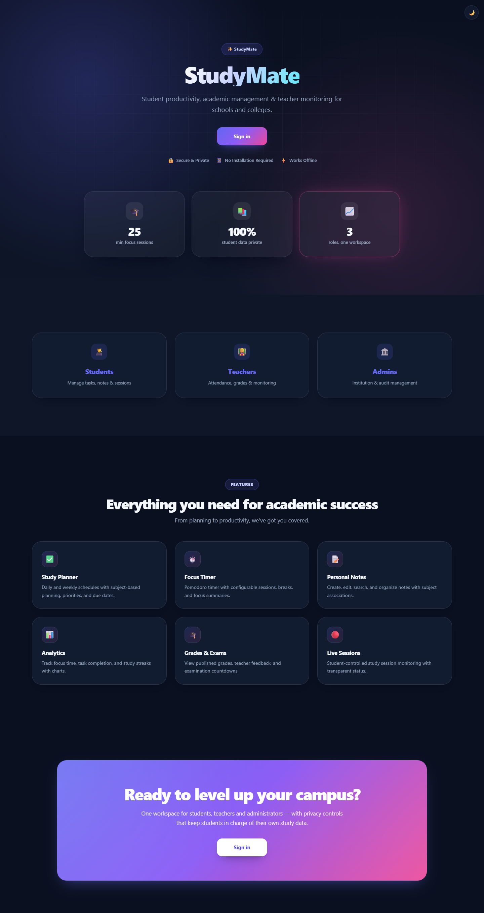
</p>

## Screenshots

### Student workspace

| Dashboard | Focus timer | Assignments |
| :---: | :---: | :---: |
| 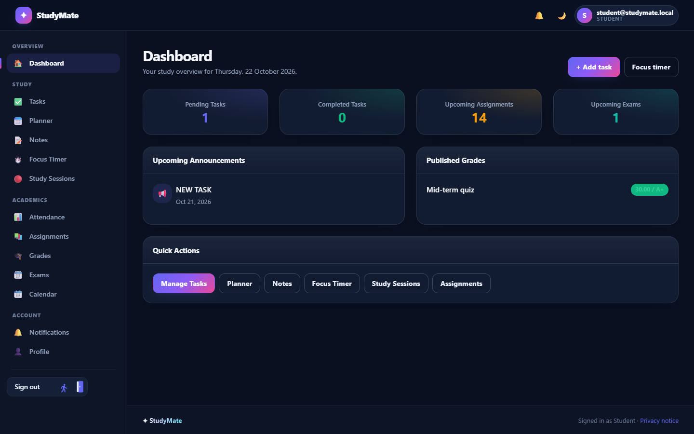 | 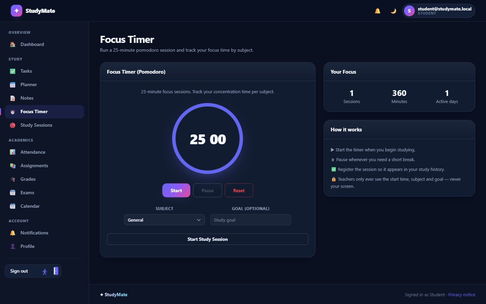 | 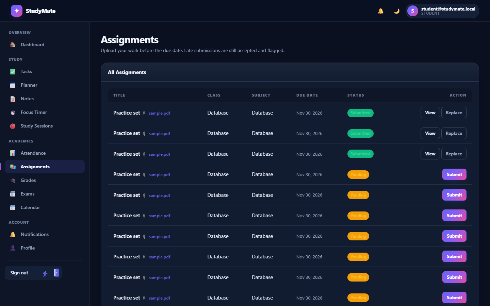 |

### Teacher workspace

| Dashboard | Attendance | Resources |
| :---: | :---: | :---: |
| 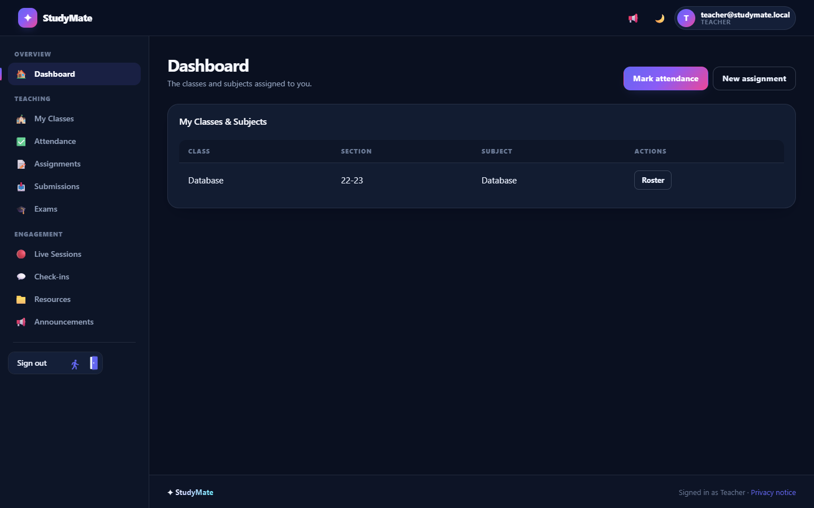 | 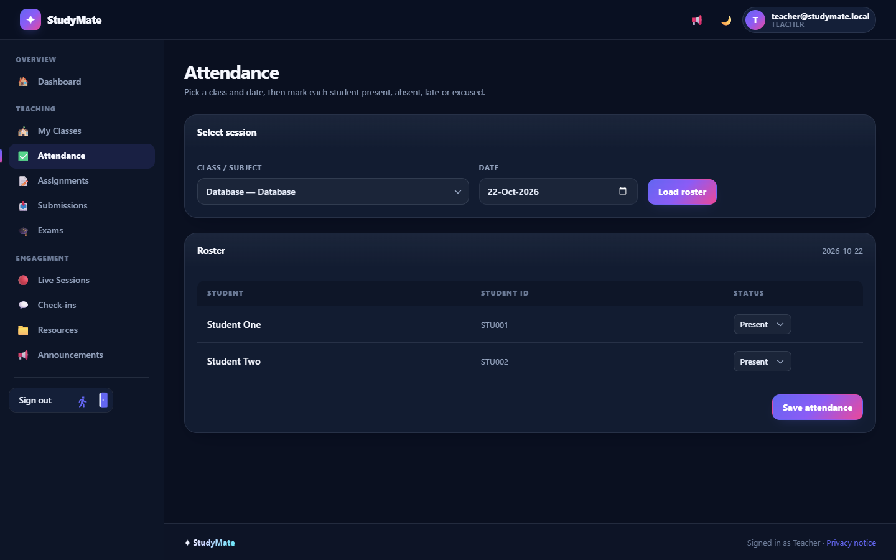 | 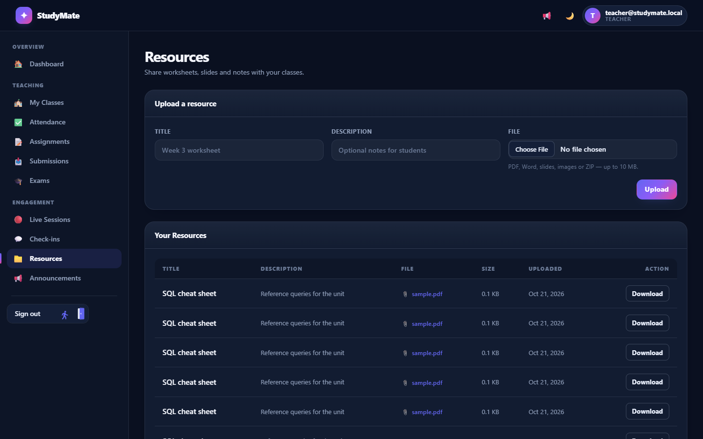 |

### Administration

| Users | Audit log |
| :---: | :---: |
| 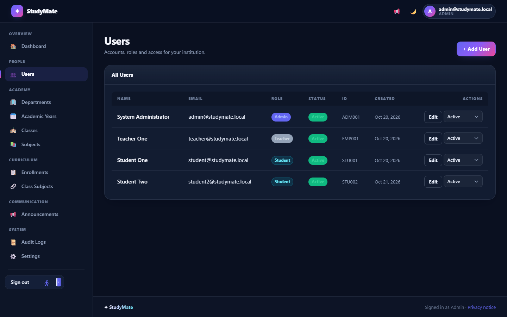 | 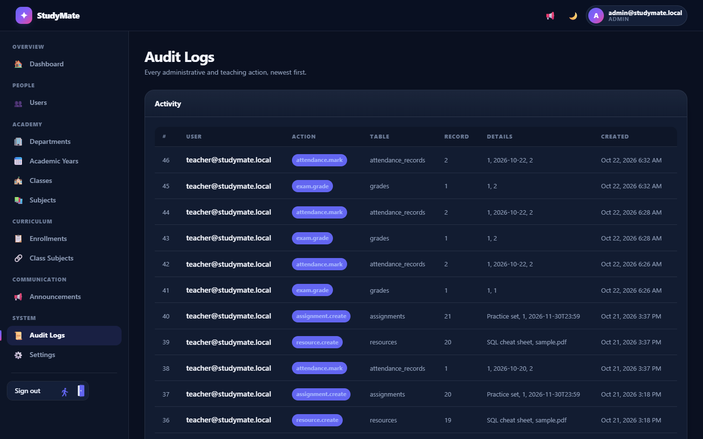 |

### Notifications &amp; confirmation

| Toast notifications | Confirmation dialog |
| :---: | :---: |
| 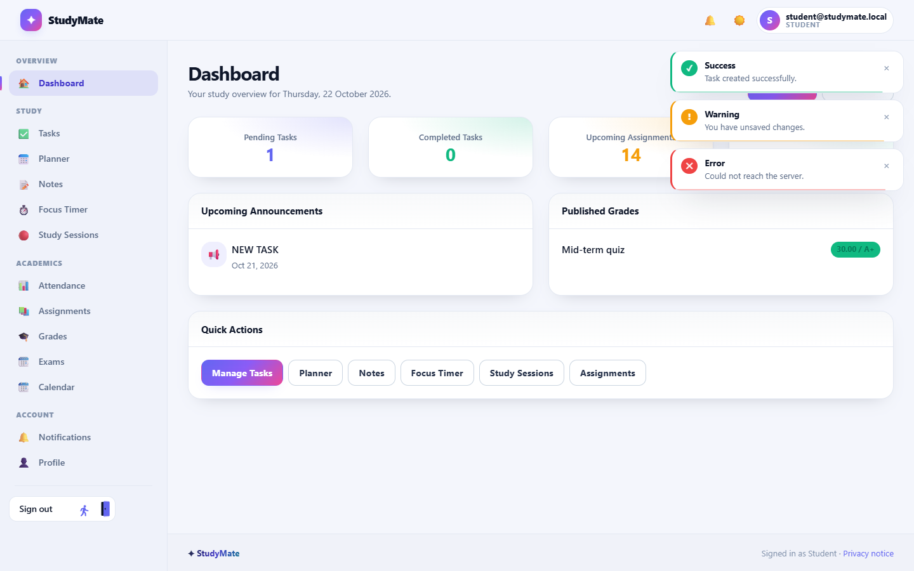 | 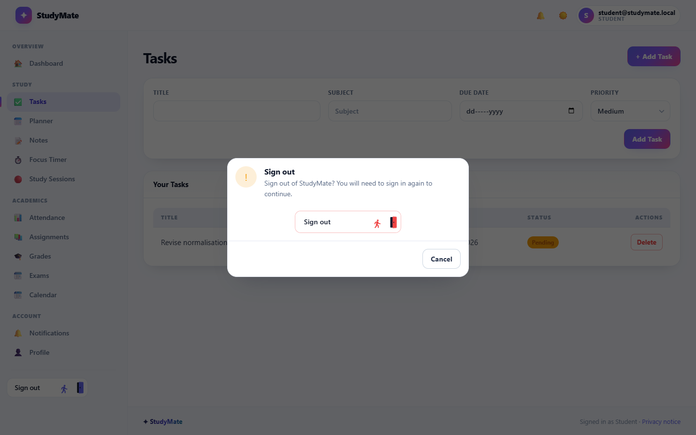 |

### Mobile

| Dashboard | Navigation drawer |
| :---: | :---: |
| 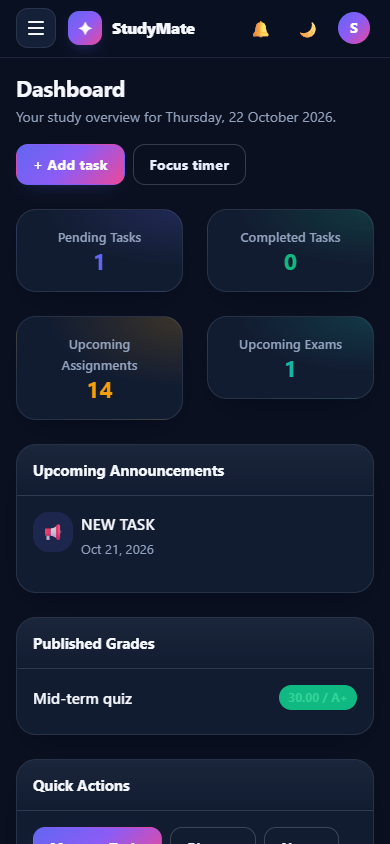 | 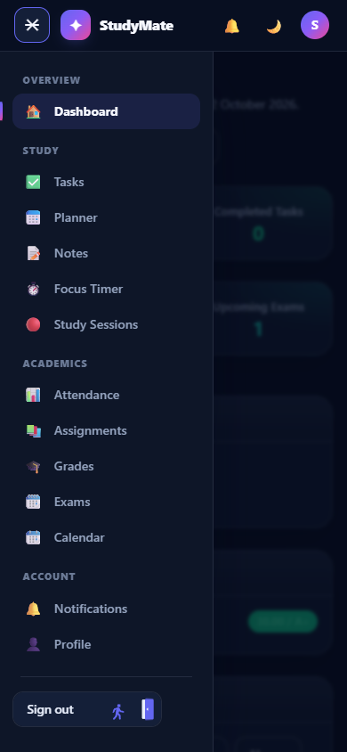 |

### Password reset

| Request a link | Choose a new password |
| :---: | :---: |
| 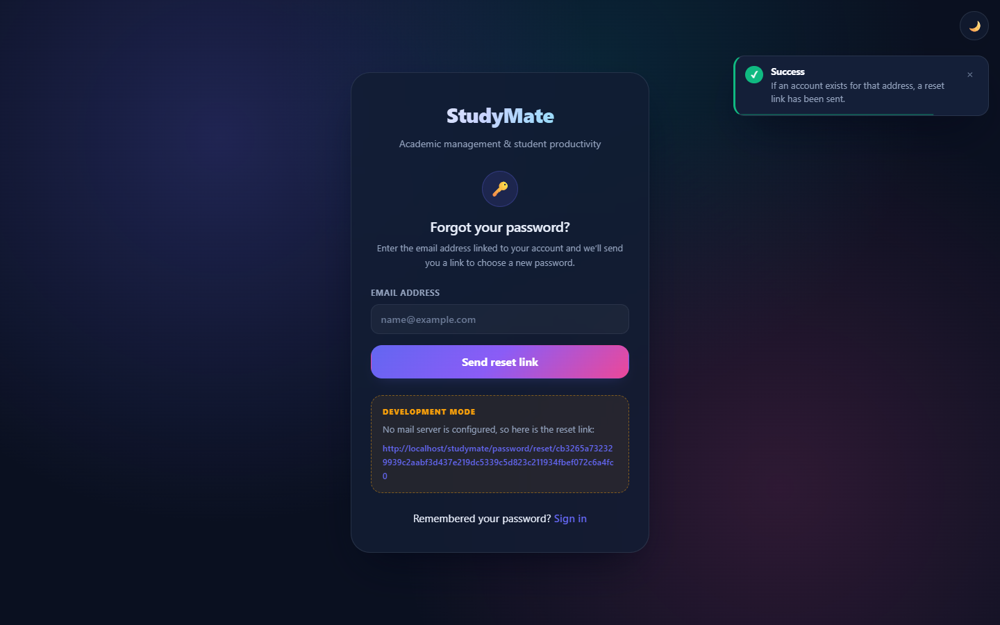 | 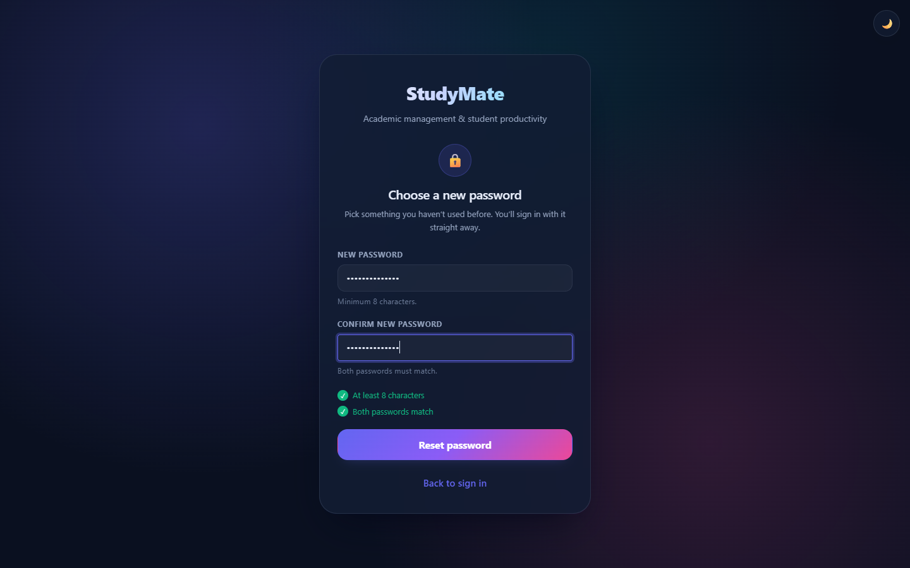 |

<p align="center">
  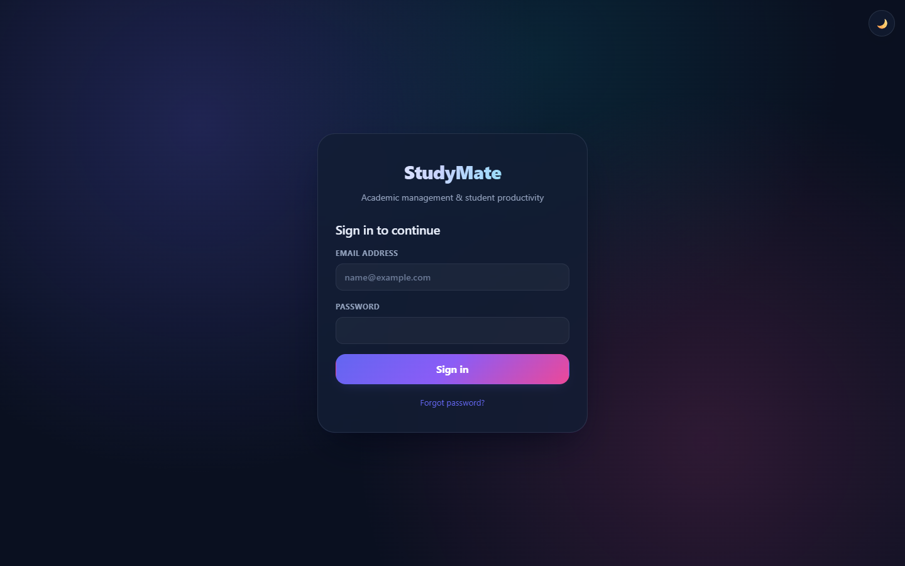
</p>

## Requirements

- PHP 8.0+ with PDO MySQL
- MySQL / MariaDB 10.4+
- Apache with `mod_rewrite` (or any web server that can route to `index.php`)
- [Composer](https://getcomposer.org) — only for PHPMailer, used to send password
  reset emails

## Setup

1. Install the dependencies:

   ```bash
   composer install
   ```

   The only package is `phpmailer/phpmailer`. Without it the application still
   runs, but password reset emails fall back to PHP's `mail()`.

2. Copy the configuration and edit it:

   ```bash
   cp .env.example .env
   ```

   `.env` holds the database credentials, `APP_URL` and the app name. It is
   **not** committed to the repository.

3. Create the database and apply the schema:

   ```bash
   php database/migrate.php
   ```

   Migrations live in `database/migrations/` and are tracked in the
   `migrations_applied` table, so `migrate.php` is safe to re-run.

4. Seed a demo dataset (optional):

   ```bash
   php database/setup.php
   ```

   This creates a department, a class with a subject, two students, a teacher,
   an administrator, an enrolment and a sample assignment.

5. Point the web server document root at the project so that
   `http://localhost/studymate/` reaches `index.php`, and make sure
   `mod_rewrite` is enabled (see `.htaccess`).

## Email

Password reset links are sent with **PHPMailer**. Configure the transport in
`.env`:

```ini
# smtp | mail | log
MAIL_TRANSPORT=smtp
MAIL_HOST=smtp.gmail.com
MAIL_PORT=587
MAIL_USERNAME=your.address@gmail.com
MAIL_PASSWORD=your-app-password
# tls | ssl | none
MAIL_ENCRYPTION=tls
MAIL_FROM_ADDRESS=no-reply@yourdomain.com
MAIL_FROM_NAME=StudyMate
```

- `smtp` — the normal choice for a hosted server
- `mail` — hand the message to the local MTA via PHP's `mail()`
- `log` — write the message to `storage/logs/mail.log` and send nothing
  (handy while developing)

For Gmail, use an **App Password** rather than your account password.

While `APP_DEBUG=true` the reset link is also shown on screen, so the flow can
be completed even before a mail server is configured.

## Demo accounts

After running `database/setup.php`:

| Role    | Email                      | Password      |
| ------- | -------------------------- | ------------- |
| Admin   | `admin@studymate.local`    | `DemoPass123!` |
| Teacher | `teacher@studymate.local`  | `DemoPass123!` |
| Student | `student@studymate.local`  | `DemoPass123!` |

## Layout

```
app/
  Core/           Front controller, router, view, database, auth, audit, mailer, upload
  Controllers/    Admin, Teacher, Student and Api controllers
  Helpers/        Global helper functions (e, url, asset, base_path, ...)
  Middleware/     Auth, guest and web (CSRF) middleware
config/           Application and database configuration
database/         Migrations and the demo seeder
public/           Document root, static assets
resources/views/   Templates, layouts and partials
routes/           web.php and api.php route tables
storage/          Uploads and logs (not committed)
tools/            Composer binary (not committed)
```

## Features

- **Students** — tasks, study planner, notes, focus timer with pomodoro
  sessions, study sessions, assignments and submissions, attendance, exams,
  grades, calendar and profile.
- **Teachers** — class rosters, attendance marking, assignments, submissions
  and grading, exams, live study-session monitoring, check-ins, resources and
  announcements.
- **Admins** — users and roles, departments, academic years, classes,
  subjects, enrolments, class-subject assignment, announcements, an audit log
  and settings.

## Design system

The UI is built on a small design system in `public/assets/css/app.css`:

- token layer (colour, surface, type, shape, motion) mapped onto Bootstrap's
  CSS variables
- dark and light themes, remembered in `localStorage`
- app shell with a grouped sidebar, off-canvas mobile drawer and a
  glass top bar
- toast notifications and confirmation dialogs for every action
- an animated logout button (`public/assets/css/logout-button.css`)

`test_desktop.php` is a self-contained regression check for the design system
and can be run from the CLI.

Screenshots live in [`docs/screenshots/`](docs/screenshots).

## Security

- CSRF tokens on every state-changing form
- output escaping through the `e()` helper
- role-based route guards and per-file authorisation for downloads
- password reset tokens are single-use, expire after an hour, and only a
  SHA-256 hash of the token is stored
- uploads validated by extension **and** sniffed MIME type, stored outside the
  document root and streamed through an authorised endpoint
- all administrative and teaching writes recorded in the audit log
